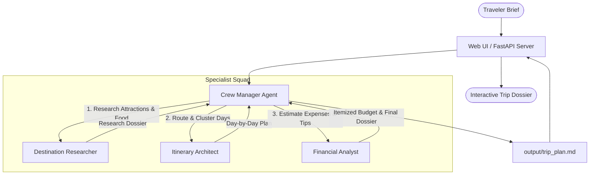

# 🧭 Wanderlust AI — Hierarchical Trip Planner

[](https://crewai.com)
[](https://fastapi.tiangolo.com)
[](https://python.org)
[](https://docker.com)
[](LICENSE)

An intelligent multi-agent travel expedition architect built with **CrewAI** and **FastAPI**. A central Manager Agent coordinates three autonomous specialists to produce comprehensive, geographically clustered itineraries and itemized financial dossiers tailored to destination, duration, budget tier, and traveler passions.

Includes a modern, responsive **Vanilla HTML/CSS/JS Single-Page Web UI** with real-time progress tracking, client-side Markdown rendering, quick presets, and export capabilities.

---

## 📸 Key Features

- **Hierarchical Multi-Agent Coordination (`Process.hierarchical`)**: A dedicated Manager LLM oversees task execution, delegates sub-goals to specialist agents, synthesizes findings, and maintains cross-task coherence.
- **3 Specialized Agents**:
  1. 🏛️ **Destination Research Specialist**: Uncovers top attractions, hidden cultural gems, local culinary scenes, seasonal weather, and neighborhood lodging bases.
  2. 🗺️ **Master Travel Itinerary Architect**: Organizes research into balanced Morning / Afternoon / Evening schedules clustered by geography with realistic transit estimates.
  3. 📊 **Travel Financial Analyst & Cost Estimator**: Calculates line-item budgets (flights, lodging, food, transit, passes, and contingency) in clear Markdown tables with budget-saving advice.
- **Dual Interface**:
  - 🖥️ **Interactive Web UI**: Built with FastAPI and pure Vanilla CSS/JS (dark aesthetic, editorial serif typography, live pipeline indicator, and export to Markdown/PDF).
  - ⌨️ **CLI First**: Full support for `crewai run`, `crewai test`, `crewai train`, and `crewai replay`.
- **Flexible Model Support**: Seamlessly swap between **Google Gemini**, **OpenAI**, **Groq**, or **Ollama (100% local and free)** via `.env`.
- **Live Web Search (Optional)**: Equips the researcher with `SerperDevTool` when an API key is present; gracefully falls back to offline LLM knowledge when absent.
- **Production Ready**: Bundled with a lightweight [Dockerfile](file:///Users/mohammedshaez/My%20Folder/Code/Temporary/AI/crew-ai/trip_planner/Dockerfile) ready for 1-click cloud deployment on Render, Railway, or Google Cloud Run.

---

## 🏛️ Architecture & Workflow



---

## 📁 Project Structure

```text
trip_planner/
├── src/
│   └── trip_planner/
│       ├── config/
│       │   ├── agents.yaml      # Agent roles, goals, and backstories
│       │   └── tasks.yaml       # Task descriptions and expected outputs
│       ├── static/              # Web application frontend assets
│       │   ├── index.html       # Single-page application layout
│       │   ├── style.css        # Custom dark-theme travel design system
│       │   └── app.js           # Client-side API caller & Markdown parser
│       ├── crew.py              # CrewBase definition and agent/task wiring
│       ├── main.py              # CLI entrypoints (run, train, test, replay)
│       └── server.py            # FastAPI REST API & static file server
├── output/
│   └── trip_plan.md             # Generated Markdown trip dossier
├── .env.example                 # Environment variable templates
├── pyproject.toml               # Project dependencies & script hooks
├── requirements.txt             # Pip-installable dependency requirements
├── Dockerfile                   # Production container build
└── README.md                    # Project documentation
```

---

## 🚀 Getting Started

### 1. Prerequisites
- Python 3.10 – 3.13
- Package manager: [uv](https://docs.astral.sh/uv/) (recommended) or `pip`

### 2. Installation

Clone this repository and navigate to the project directory:

```bash
git clone <your-repo-url>
cd trip_planner
```

Create a virtual environment and install dependencies:

```bash
# Using uv (fastest)
uv venv
source .venv/bin/activate
uv pip install -e .

# OR using standard pip
python -m venv .venv
source .venv/bin/activate
pip install -r requirements.txt
pip install -e .
```

### 3. Environment Configuration

Copy the example environment file:

```bash
cp .env.example .env
```

Open `.env` and set your preferred model and API key:

#### Option A: Google Gemini (Active Default)
```env
MODEL=gemini/gemini-2.0-flash
GEMINI_API_KEY=your_gemini_api_key_here
```

#### Option B: OpenAI
```env
MODEL=gpt-4o-mini
OPENAI_API_KEY=your_openai_api_key_here
```

#### Option C: Groq (Ultra-Fast Llama)
```env
MODEL=groq/llama-3.3-70b-versatile
GROQ_API_KEY=your_groq_api_key_here
```

#### Option D: Ollama (100% Offline & Free)
```env
MODEL=ollama/llama3.1
OLLAMA_BASE_URL=http://localhost:11434
```

*(Optional)* Enable real-time Google search by adding a free key from [serper.dev](https://serper.dev):
```env
SERPER_API_KEY=your_serper_key_here
```

---

## 🖥️ Running the Application

### 1. Launch the Interactive Web UI

Start the local FastAPI server:

```bash
uv run ui
# or: uvicorn trip_planner.server:app --reload --port 8000
```

Open your browser to:
👉 **`http://127.0.0.1:8000`**

- Select a quick preset (e.g. Kyoto 5-Day, Iceland 4-Day, Italy 7-Day) or enter custom parameters.
- Click **"Kickoff Multi-Agent Crew"** to watch the real-time pipeline status.
- Copy, download as `.md`, or print the resulting travel dossier.

---

### 2. Run via CLI

Execute the trip planner directly from your terminal:

```bash
crewai run
# or: python src/trip_planner/main.py
```

The resulting itinerary and budget breakdown will print to the console and save automatically to `output/trip_plan.md`.

---

## 🧪 Testing, Training & Replaying

### Model-Graded Evaluation (`test`)
Evaluate your crew's output quality using an evaluator model:

```bash
crewai test -n 2 -m gemini/gemini-2.0-flash
# or: crewai test -n 2 -m gpt-4o-mini
```

### Agent Training (`train`)
Train the agents over multiple iterations for human feedback and caching:

```bash
crewai train 2 trained_agents.pkl
```

### Task Replay (`replay`)
Replay execution starting from a specific task ID:

```bash
crewai replay <task_id>
```

---

## 🐳 Docker & Cloud Deployment

### Run Locally with Docker

```bash
docker build -t wanderlust-trip-planner .
docker run -p 8000:8000 --env-file .env wanderlust-trip-planner
```

Visit `http://localhost:8000`.

### Deploy to Render.com (1-Click)
1. Push your code to GitHub.
2. In Render, select **New ➔ Web Service** and link your repo.
3. Configure:
   - **Root Directory**: `trip_planner`
   - **Build Command**: `pip install -r requirements.txt && pip install -e .`
   - **Start Command**: `uvicorn trip_planner.server:app --host 0.0.0.0 --port $PORT`
4. Add your `MODEL` and `GEMINI_API_KEY` in **Environment Variables**.

### Deploy to Railway.app
1. Go to Railway ➔ **New Project ➔ Deploy from GitHub repo**.
2. Set the root directory to `trip_planner`.
3. Add `GEMINI_API_KEY` and `MODEL` in **Variables**. Railway will automatically detect the [Dockerfile](file:///Users/mohammedshaez/My%20Folder/Code/Temporary/AI/crew-ai/trip_planner/Dockerfile) and deploy.

### Deploy to Google Cloud Run
```bash
gcloud run deploy trip-planner \
  --source . \
  --region us-central1 \
  --allow-unauthenticated \
  --set-env-vars "MODEL=gemini/gemini-2.0-flash,GEMINI_API_KEY=your_key"
```

---

## 📄 License

This project is licensed under the MIT License — see the [LICENSE](LICENSE) file for details.
